<p align="center">
  
</p>

# MonoTempo

Firmware and services for the **MyTempo 50x** series of RFID timing portals
(`PORTAL LEITOR RFIDMY501`, `RFIDMY503`, …): self-contained boxes that read UHF tags
on athletes' bibs at the start and finish of a race, store every read locally and
upload start/finish times to the MyTempo platform.

> **Historical repository.** This is the code that ran on the 50x units from
> July 2024 to February 2026. It is kept for reference and is no longer maintained.

<p align="center">
  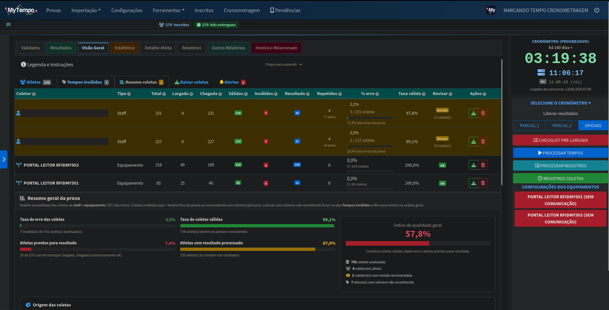
  <br><sub>Reads from two 50x portals in the MyTempo dashboard after an event (event and staff names redacted).</sub>
</p>

## Contents

- [Architecture](#architecture)
- [Design decisions](#design-decisions)
- [Installation](#installation)
- [How each part works](#how-each-part-works)
  - [MyReader](#myreader)
  - [RabbitMQ topology](#rabbitmq-topology)
  - [Envio](#envio)
  - [AA2 and the Arduino screen](#aa2-and-the-arduino-screen)
  - [Chancelor and Provost](#chancelor-and-provost)
  - [Receba, Reenvio and Validate](#receba-reenvio-and-validate)
- [Repository layout](#repository-layout)
- [History](#history)

## Architecture

Each unit is a small Arch Linux PC wired to an RFID reader (Chafon or Impinj), an
Arduino Mega with a 20x4 LCD and two buttons, and a 12 V battery. Software is split
into an **Offline** half that runs for the whole event without needing internet,
and an **Online** half that runs on demand to sync with the MyTempo API.

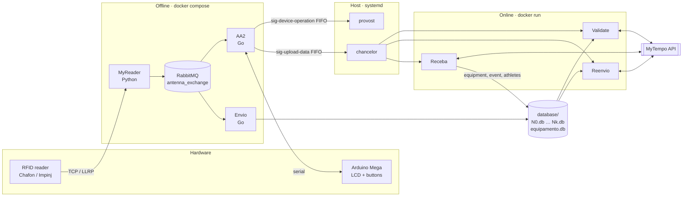

| Component | Language | Role |
| --- | --- | --- |
| [MyReader](Offline/MyReader) | Python, C++ | Talks to the reader and publishes every tag to RabbitMQ |
| [mytempo-chafon-reader](Offline/MyReader/mytempo-chafon-reader) | C++ | Python extension (`pychafon`) wrapping the Chafon vendor SDK |
| [Envio](Offline/Envio) | Go | Consumes tags and stores them across sharded SQLite files |
| [AA2](Offline/AA2) | Go, Arduino C++ | Drives the LCD, reads button actions, monitors network/reader/USB |
| [chancelor](System/chancelor) | sh | Supervisor: starts/stops the offline stack, runs uploads, backups, updates |
| [provost](System/provost) | sh | Resets Wi-Fi / 4G connections on request |
| [Receba](Online/Receba) | Go | Downloads equipment, event, track, staff and athlete data |
| [Reenvio](Online/Reenvio) | Go | Computes start/finish times and uploads them |
| [Validate](Online/Validate) | Go | Uploads the list of chips seen, for pre-race kit validation |

## Design decisions

- **Offline first.** Races happen in places with bad connectivity. Reading and
  storing never depends on the network; uploading is a separate, retryable step
  triggered from the screen or by the 5-minute auto-upload.
- **A message broker between reader and consumers.** The reader process only
  publishes. Storage (Envio) and the display (AA2) each get their own queue on the
  same topic exchange, so a slow LCD never blocks writes, and either side can
  restart independently.
- **Store everything, decide later.** No filtering or deduplication happens at read
  time. Every read is written; start/finish times are derived by SQL at upload time,
  when the track windows from the API are known.
- **Many small SQLite files instead of one.** Sidesteps SQLite's single-writer lock
  without a database server, and keeps each file small enough to snapshot and ship.
  See [Envio](#envio).
- **Named pipes as the control plane.** The containers signal the host by writing a
  word into a FIFO. `chancelor` and `provost` block on `read`; no sockets, no polling.
- **Crash and restart over recovery logic.** Containers use `restart: always` and
  services exit on unrecoverable errors (the Chafon SDK, for example, only reconnects
  reliably after a full process restart).
- **MySQL → SQLite (March 2025).** Early versions used MySQL and PHP; the move to
  embedded SQLite (pure-Go `modernc.org/sqlite`) removed a server from a battery-powered box.

## Installation

Target: an x86 PC running **Arch Linux** with Docker. Run as root from the repository root.

```bash
./install full
```

This will:

1. Install `docker-buildx` and `jq` via `pacman`.
2. Create `shared.env` and `Offline/AA2/aa2.env` from their `.in` templates.
3. Create `database/` (with `backup/`, `envio/`, `logs/`) and the two control FIFOs.
4. Install `chancelor` and `provost` into `/usr/local/bin` and link their systemd units.
5. Disable USB autosuspend in GRUB and switch to `NetworkManager-wait-online`.
6. Build all Docker images (`./build`).
7. Prompt for the device ID (`501`, `503`, …), reader type (`chafon`/`impinj`),
   Arduino serial path (`ttyUSB0`/`ttyACM0`), API base URL and HTTP scheme, then set
   the hostname to `my<ID>` and fill in the env files.

Then enable the services and reboot:

```bash
systemctl enable chancelor provost
```

`./install` with no argument performs an update (rebuild only), and `./install
no_manual_setup` is the non-interactive form used by the on-device updater.
`./uninstall` disables the services, resets the tree and prunes Docker.

The optional [scripts/Time-config](scripts/Time-config) sets up NTP against the
Brazilian pool and the `America/Sao_Paulo` timezone.

### Configuration

`shared.env` (shared by every container):

| Variable | Description |
| --- | --- |
| `MYTEMPO_API_URL` | API host, e.g. `api.v2.mytempo.esp.br` |
| `API_REQ_SECURITY` | `http` or `https` |
| `MYTEMPO_READER_TYPE` | `chafon` or `impinj` (anything else means Impinj) |
| `MYTEMPO_EQUIP`, `MYTEMPO_READER` | Device name registered in the API, `PORTAL LEITOR RFIDMY<ID>` |
| `MYTEMPO_DEVID` | Numeric device ID |
| `READER_IP` | Impinj reader address (`host[:port]`); Chafon is fixed at `192.168.1.200` |
| `READER_SUBTYPE` | `R420` selects Impinj search mode 0, otherwise mode 2 |
| `RABBITMQ_*` | Broker host, port and credentials |
| `TZ` | Timezone (`Brazil/East`) |

`Offline/AA2/aa2.env` holds `READER_NAME` and `READER_PATH`, the Arduino's serial device.

## How each part works

### MyReader

A small Python service ([server.py](Offline/MyReader/server.py)) that picks a reader
implementation from `MYTEMPO_READER_TYPE` and hands it a RabbitMQ `TagSender`.
Both readers share `BaseReader` and produce `Tag` objects (EPC, timestamp,
antenna). An `EPC` is parsed by taking the 4-digit decimal groups out of the tag's
hex code; the last group is the athlete's bib number.

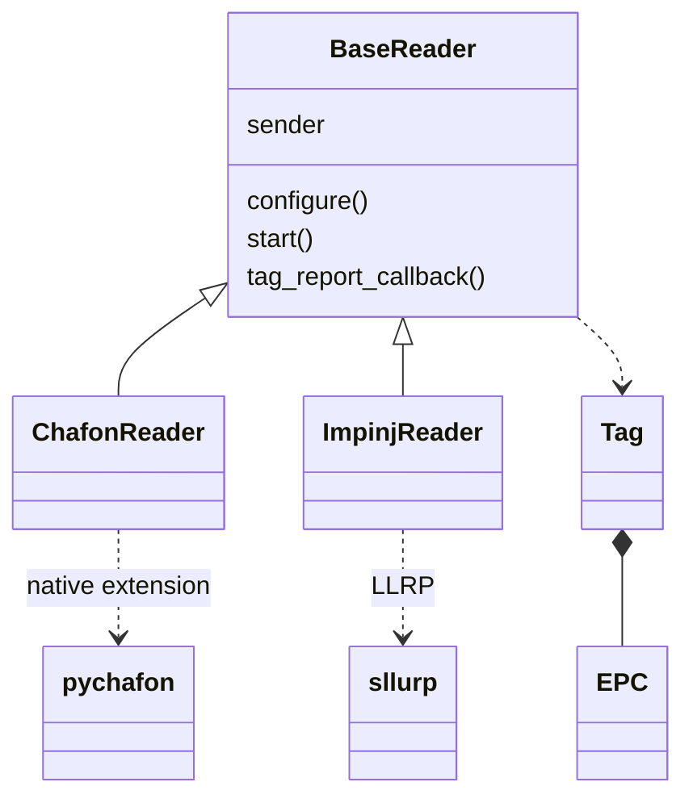

Timestamps are taken on the PC at the moment the read arrives, in
`America/Sao_Paulo`. Reads whose year doesn't match the current year are
re-stamped, which protects against units booting with a dead RTC.

#### Chafon

<p align="center">
  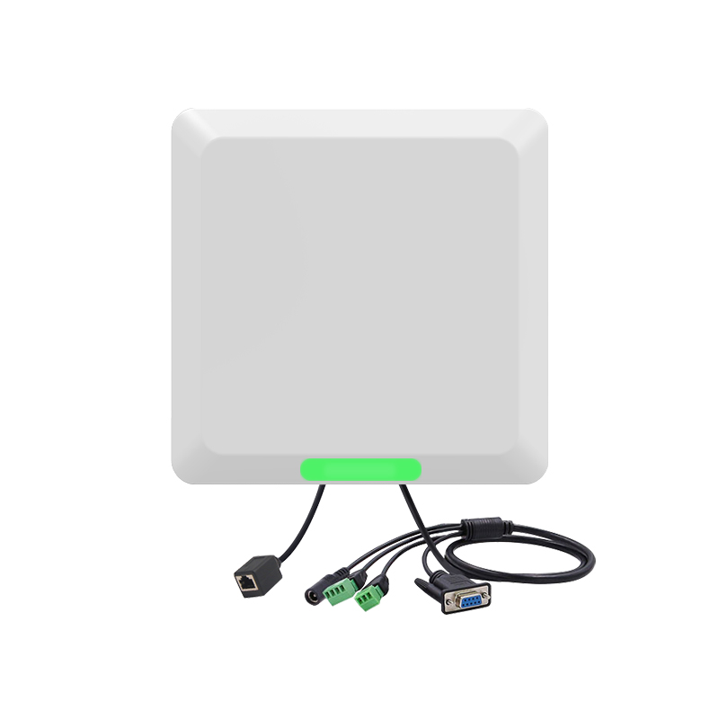
</p>

The Chafon is an integrated reader/antenna panel controlled through a closed vendor
SDK (`libCFApi.so`). [mytempo-chafon-reader](Offline/MyReader/mytempo-chafon-reader)
wraps it in a C++ `Reader` class and exposes it to Python as the `pychafon` module
(`open`, `setTagCallback`, `read`, `close`).

The reader is reached over TCP at `192.168.1.200:2022`. `read(0)` starts continuous
inventory and loops on `GetTagUii` forever. The blocking call releases the GIL; each
tag is hex-encoded and passed to the Python callback, which publishes it. Chafon
reads are always reported as antenna 1.

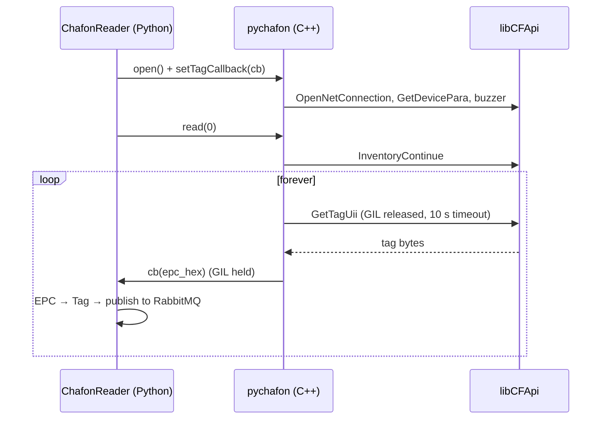

If the connection fails, the process exits and the container restarts it: the SDK
doesn't reconnect reliably without being reloaded.

#### Impinj

<p align="center">
  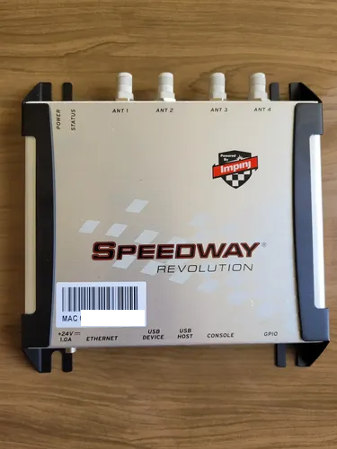
</p>

Impinj Speedway readers (up to four antennas) are driven over LLRP with
[sllurp](https://github.com/sllurp/sllurp). The client connects to `READER_IP`
(port 5084), reads all antennas at full power in session 0, and requests
`AntennaID`, first/last seen and seen count per report. `configure()` is retried
every 2 s until the reader answers, and sllurp handles reconnects afterwards.
Unlike the Chafon, the antenna ID is preserved, so each port gets its own routing key.

### RabbitMQ topology

MyReader publishes JSON to the durable topic exchange `antenna_exchange` with
routing key `antenna.<n>`:

```json
{"epc": 1234, "antena": 1, "tempo_formatado": "07:46:12.345", "refinado_mytempo": "0011234…07:46:12.345"}
```

Envio and AA2 each bind their own queue to `antenna.#`, so both receive the full
stream independently.

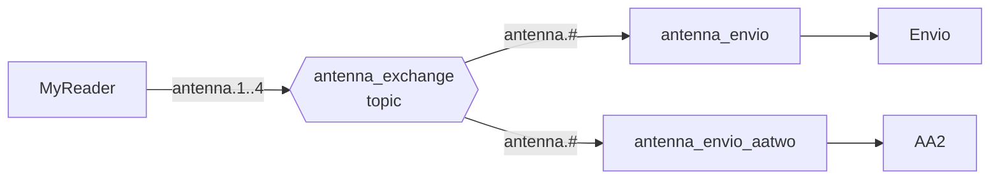

The management UI is exposed on port `15672` for debugging on site.

### Envio

Envio stores every tag in SQLite. The interesting part is how it writes from
several goroutines without fighting over SQLite's lock.

**Sharding.** SQLite allows one writer per database *file*. Envio's `MADB` keeps
a slice of *baselets*, each a separate file `N<i>.db` that holds bib numbers
`[10·i, 10·i + 9]`. A read for bib 1234 goes to `N123.db`. Files are created on
demand as higher bibs show up.

**Concurrency.** Each baselet owns its own connection and a dedicated writer
goroutine fed by an unbuffered channel. Writes to the same file are serialized by
that channel; writes to different files run in parallel and never contend, because
SQLite locks per file.

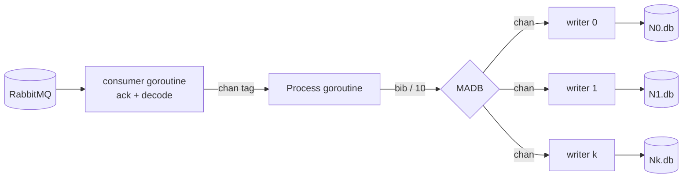

Each writer retries failed inserts with exponential backoff (100 to 500 ms, 2 s
total). A hand-off that blocks for more than 2.1 s closes the baselet. Databases
run with `synchronous = OFF` and `journal_mode = MEMORY` for speed on slow storage.
Durability comes instead from chancelor's file-level backups and from the reader
being stopped 10 s before the rest of the stack on shutdown, so in-flight writes drain.

Schema (one table per file):

```sql
CREATE TABLE athletes_times (
  id INTEGER PRIMARY KEY AUTOINCREMENT,
  antenna INTEGER NOT NULL,
  athlete_num INTEGER NOT NULL,
  staff INTEGER NOT NULL,
  athlete_time TEXT
);
```

The same layout is reused on the read side: Reenvio opens every `N*.db` with one
goroutine per file and streams each file's results as one upload batch.

### AA2 and the Arduino screen

AA2 consumes the tag stream to keep live counters, and talks to an Arduino Mega
(20x4 I2C LCD, *next* and *action* buttons) over serial at 115200 baud.

**Counters.** Total reads, unique tags since the last reset, and unique tags for
the whole event. The event-wide set is seeded at boot from a `TAGS` file that
chancelor generates from existing databases. Unique sets are mutex-guarded hash
sets with an atomic counter.

#### Serial protocol

USB serial at 115200 baud, 8N1. AA2 talks on a fixed 120 ms cadence, and the
Arduino only speaks when a button is pressed.

**Frames (PC → Arduino)** are newline-terminated, NMEA-style:

```
$MYTMP;<tags>;<unique>;<type>;<fields…>;<epoch>*<checksum>
```

- `checksum` is the XOR of every byte between `$` and `*`, as two hex digits. The
  Arduino folds the received checksum into the same XOR and accepts the frame only if
  the result is 0. Invalid frames are dropped silently.
- `epoch` is Unix time **plus the local UTC offset**, so the Arduino can show local
  time without timezone tables.
- `tags` and `unique` lead every frame, so the counters update whatever the type.

| Type | Fields after `<type>` | Example |
| --- | --- | --- |
| `T` tags | – | `$MYTMP;1520;342;T;1744846380*3D` |
| `A` antennas | level of antennas 1–4 (0–3) | `$MYTMP;1520;342;A;3;2;0;0;1744846380*29` |
| `P` PC data | API ok, reader ok, USB present, auto-upload on, version, serial no., backups, event-wide unique tags | `$MYTMP;1520;342;P;1;1;0;1;666;501;3;980;1744846380*38` |
| `L` log | uploads, databases, avg. processing ms, errors, last status | sent 5 times at boot, from `logs/pc.log` |

A 400 ms ticker steps through `T T T A A P P`, so tag counts are on screen most of
the time. Chafon units have no per-antenna data, so they send `P` in the `A` slots. The
Arduino hides the antenna screen until it has seen an `A` frame, and the log screen
until it has seen an `L` frame.

**Actions (Arduino → PC)** are 10 bytes, `$MYTMP;<screen>`, with no checksum or
newline. AA2 polls for them after each report, scans for `$` and maps the screen
index to a command:

| Screen | # | Action | Where it goes |
| --- | --- | --- | --- |
| Info | 0 | Reset session counters and signal windows | AA2 only |
| Network config | 3 | Reconnect Wi-Fi | `sig-device-operation` → provost |
| USB | 4 | Dump reads to USB (`stats`) | `sig-upload-data` → chancelor |
| System | 6 | Update from git (`update`) | 〃 |
| Auto-upload | 7 | Toggle (`auto_up`) | 〃 |
| Upload | 8 | Upload times (`normal`) | 〃 |
| Validate | 9 | Validate chips (`validate`) | 〃 |
| Delete | 10 | Erase data (`reset`), asks for confirmation | 〃 |
| Shutdown | 11 | Power off (`poweroff`), asks for confirmation | 〃 |

Antennas (1), network status (2), date/time (5), battery (12) and last upload log (13)
are display-only.

**Lock handshake.** There is no explicit acknowledgement. The Arduino locks the
screen after sending any action above screen 2 (except date/time), and unlocks only
after **three** valid frames arrive. For long-running commands AA2 writes to the FIFO
and then blocks forever, so the frames stop. The "waiting" screen therefore stays up
for exactly as long as chancelor is working, and clears when chancelor brings the
stack back up and a fresh AA2 starts reporting again. Requiring three frames prevents
a stray frame that was already in flight from unlocking the screen early. Boot uses the same lock, so the
screen reads "starting…" until AA2 is up.

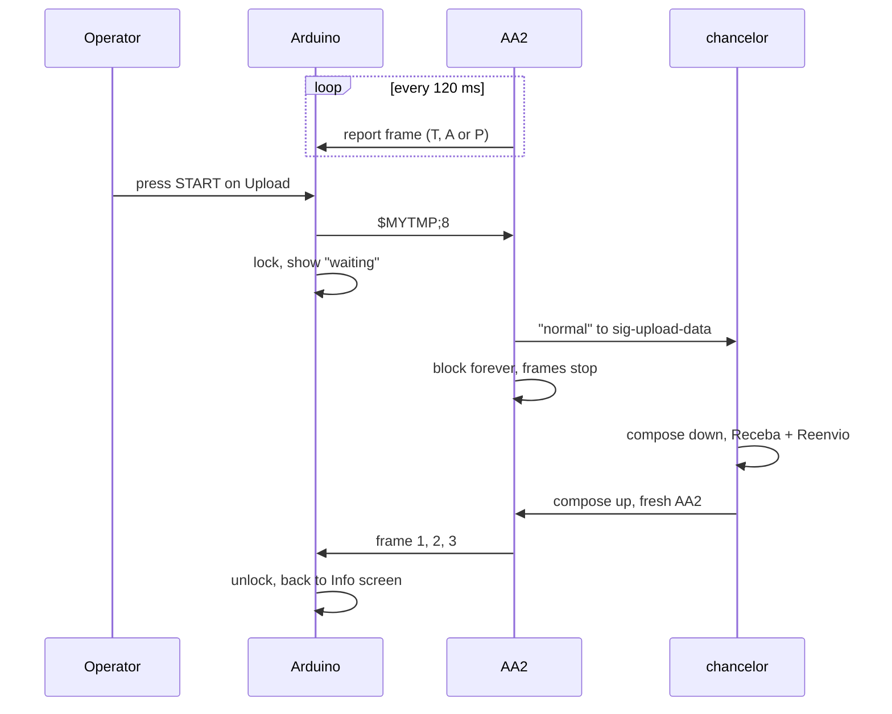

Shutdown is the exception. The Arduino shows a 30 s countdown, turns off the
backlight and puts the MCU to sleep, while chancelor powers the PC off.

#### Signal, status and battery

**Antenna signal.** Each antenna keeps a 250 ms sliding window of read timestamps
and maps the read rate to signal bars:

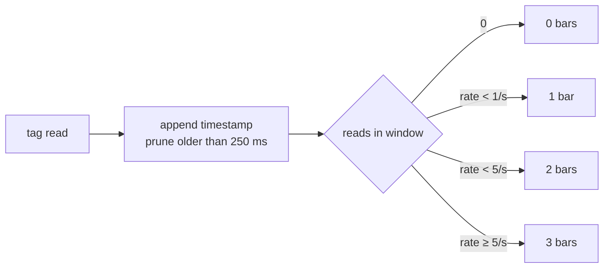

**Status.** A JSON ping to `/status/device` every 14 s sets the network
indicator; an ICMP ping to the reader every 4 s sets the reader indicator; `/sys/block`
is scanned for USB mass storage.

**Battery.** The Arduino reads battery voltage on A0 through a 5:1 divider every
500 ms and beeps below 11 V.

### Chancelor and Provost

`chancelor` is the systemd-managed supervisor. It owns the event lifecycle: it brings
the offline stack up, then blocks on the `sig-upload-data` FIFO until the screen
asks for something.

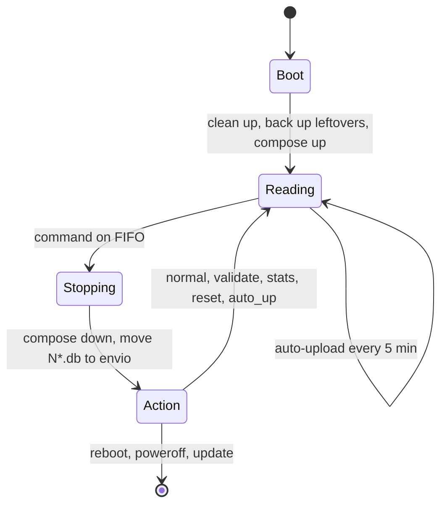

| Command | Effect |
| --- | --- |
| `normal` | Run Receba, then Reenvio over every backup directory |
| `validate` | Run Receba, then Validate over every backup directory |
| `stats` | Dump all reads to `MYTEMPO_<time>.txt` on a USB stick, plus unique tags and logs |
| `reset` | Erase backups and stored reads |
| `auto_up` | Toggle auto-upload |
| `update` | `git pull`, reinstall, reboot |
| `reboot`, `poweroff` | As named |

Auto-upload copies the live `N*.db` files into a snapshot directory and uploads
them while reading continues. A `mkdir` lock keeps it from overlapping a manual upload.
Backups older than the current day are deleted at boot.

`provost` blocks on `sig-device-operation` and cycles the `MyTempo` Wi-Fi or the
`chip` 4G connection (an Android modem) with `nmcli`.

### Receba, Reenvio and Validate

These run as one-shot containers (`docker run --network=host`) launched by chancelor.

**Receba** resolves the device by name (`/fetch/device`), then fetches the event,
its tracks, staff and athletes. It writes them to a fresh `equipamento.db`.

**Reenvio** attaches `equipamento.db` to every `N*.db` and derives times in SQL,
using each athlete's track windows:

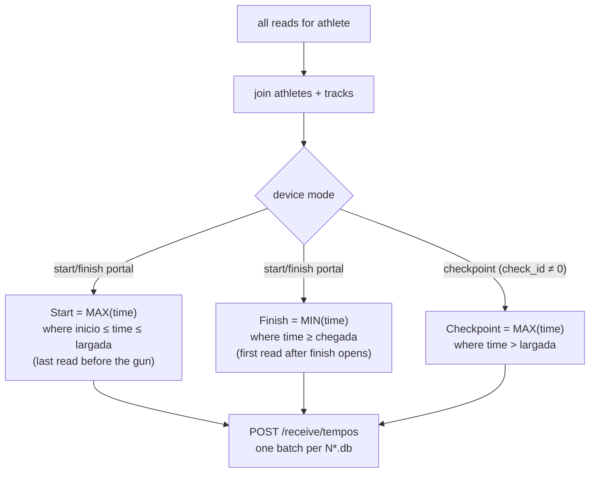

Uploads retry with exponential backoff for up to 5 minutes. If the API reports that
the event date doesn't match today, Reenvio exits with code 78 so chancelor doesn't
keep retrying.

**Validate** sends `SELECT DISTINCT athlete_num` to the chip-validation endpoint,
so staff can confirm at kit pickup that every bib's chip reads.

## Repository layout

```
.
├── install, uninstall, build   # host setup and image builds
├── shared.env.in               # configuration template
├── System/                     # chancelor, provost and their systemd units
├── Offline/
│   ├── docker-compose.yml      # rabbitmq, myreader, envio, aa2
│   ├── *.offline               # compose wrappers (setup, stop, pause, logs)
│   ├── MyReader/               # Python reader service + Chafon C++ extension
│   ├── Envio/                  # tag storage
│   └── AA2/                    # screen service + Arduino/ sketches
├── Online/
│   ├── *.online                # docker run wrappers
│   ├── Receba/                 # API download
│   ├── Reenvio/                # time upload
│   └── Validate/               # chip validation upload
├── scripts/                    # NTP setup, DB inspection helpers
└── docs/img/                   # README images
```

## History

| Period | Milestone |
| --- | --- |
| Jul–Oct 2024 | Container layout, MyReader, Chafon extension, Receba and a MySQL/PHP storage backend |
| Jan 2025 | AA2 screen service |
| Mar 2025 | Move from MySQL to sharded SQLite; Reenvio; chancelor reorganized |
| Mar–Apr 2025 | Provost; Arduino rewrite with SafeString and on-screen actions |
| Dec 2025 | Chip validation (Validate), configurable API URL and scheme |
| Feb 2026 | Unified backup/upload flow, 5-minute auto-upload with live snapshots, antenna signal bars, RabbitMQ management UI |
